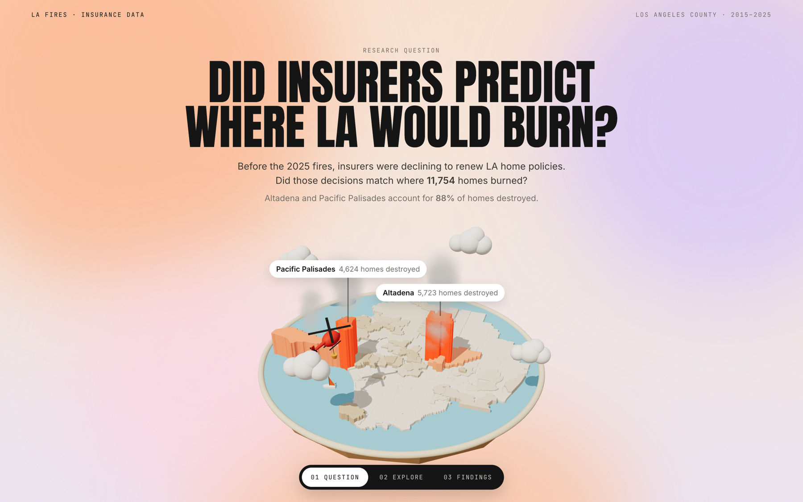
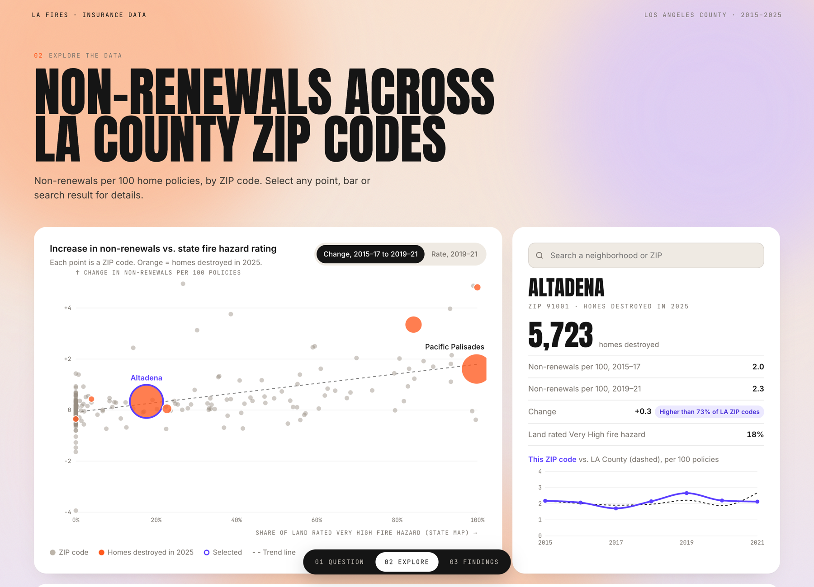
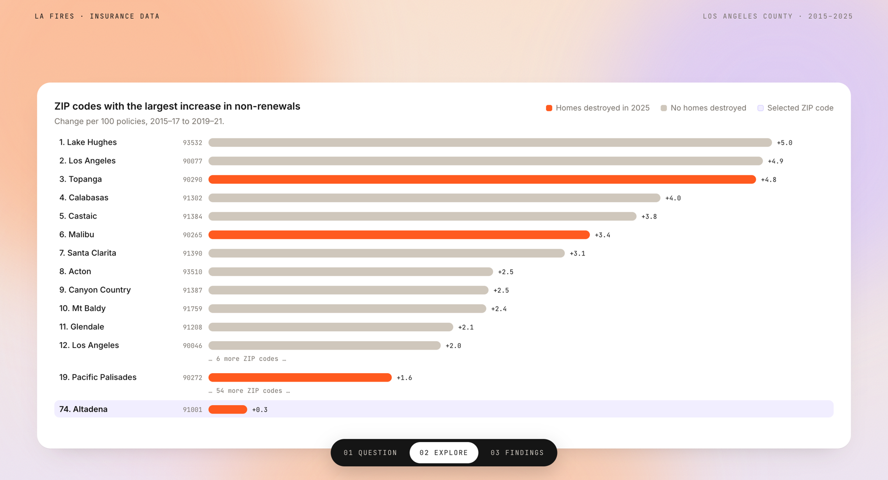
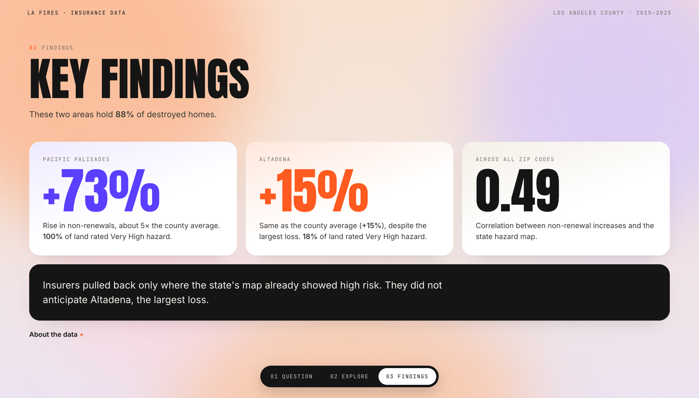

# 🔥 Did Insurers Predict Where LA Would Burn?

**Before the January 2025 Eaton and Palisades fires, insurers were declining to renew Los Angeles home policies. Did those decisions match where 11,754 homes burned?**

[](https://corinnebish.github.io/la-fire-insurer-foresight/)

### 👉 [**Open the live project**](https://corinnebish.github.io/la-fire-insurer-foresight/): no download or setup needed

---

## What it does
Compares insurer non-renewals (policies an insurer chose not to renew, per 100 up for renewal) for 277 LA County ZIP codes with CAL FIRE's inspection of every home damaged in the 2025 fires, and with the state's pre-fire Fire Hazard Severity Zone map. The results are presented in an interactive page: a 3D model of the LA basin, linked charts for every ZIP code, and the findings.

## The Project

| Research question | Explore every ZIP code |
|---|---|
|  |  |
| **Largest increases in non-renewals** | **Key findings** |
|  |  |

---

## Key results
- **11,754 homes destroyed**; **88%** were in two communities, Altadena (Eaton Fire) and Pacific Palisades (Palisades Fire)
- **Pacific Palisades:** non-renewals rose from 2.2 to 3.8 per 100 policies (**+73%**), about 5× the county-wide increase; the state rated 100% of its land Very High fire hazard
- **Altadena:** non-renewals rose from 2.0 to 2.3 per 100 (**+15%**), identical to LA County overall, despite the largest loss of any community; the state rated only 18% of its land Very High hazard. It ranked 74th of 277 ZIP codes for rising non-renewals
- Increases in non-renewals tracked the state hazard map (rank correlation **0.49**). The 10% of ZIP codes with the largest increases held 49% of destroyed homes, the same share the hazard map alone identified
- **Conclusion:** insurers pulled back only where the state's map already showed high risk, and did not anticipate Altadena

## How it works
| Step | What happens | Code |
|---|---|---|
| 1. Collect | Download Department of Insurance policy counts by ZIP code (2015–2023), CAL FIRE damage inspections, pre-2025 hazard maps, ZIP boundaries and fire perimeters | [`src/fetch_data.py`](src/fetch_data.py) |
| 2. Clean | Keep LA County; compute insurer-initiated non-renewal rates; keep the 2015–21 and 2020–23 files separate because they define non-renewals differently; assign each destroyed home to a ZIP code by location | [`src/build_table.py`](src/build_table.py) |
| 3. Analyze | Rank ZIP codes on each risk signal; compare burned areas with the county and with hillside areas that did not burn | [`src/analyze.py`](src/analyze.py) |
| 4. Export | Package per-ZIP data and 3D shapes for the page | [`src/export_web.py`](src/export_web.py) |
| 5. Present | Interactive page (three.js 3D model + D3 charts), served full-screen by Streamlit | [`site/index.html`](site/index.html), [`app/streamlit_app.py`](app/streamlit_app.py) |

**Key design decision:** the hazard map used for comparison is the one in effect *before* the fires, so the state is not given hindsight.

## Limitations
- Data is by ZIP code, not by individual home
- Insurance data ends in 2023, the year before the fires
- Only seven ZIP codes had significant damage, so results are rankings and comparisons rather than a statistical model

## Data sources
- [California Department of Insurance](https://www.insurance.ca.gov/01-consumers/200-wrr/DataAnalysisOnWildfiresAndInsurance.cfm): new, renewed and non-renewed residential policies by ZIP code
- CAL FIRE damage inspections (DINS), Fire Hazard Severity Zones and fire perimeters, via LA County's public ArcGIS services

## Tech
Python · pandas · GeoPandas · SciPy · three.js · D3 · Streamlit

## Run it yourself (optional)
```bash
pip install -r requirements.txt
python src/fetch_data.py && python src/build_table.py && python src/analyze.py && python src/export_web.py
streamlit run app/streamlit_app.py
```
